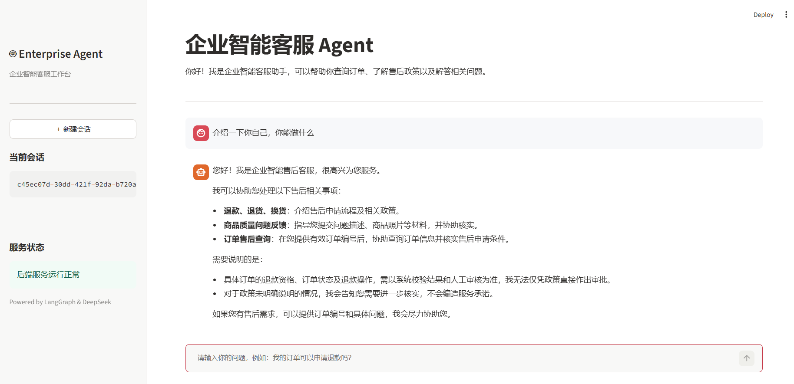
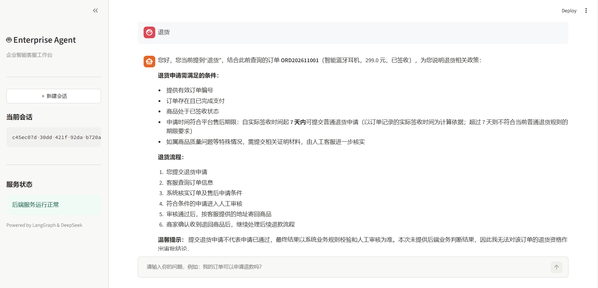
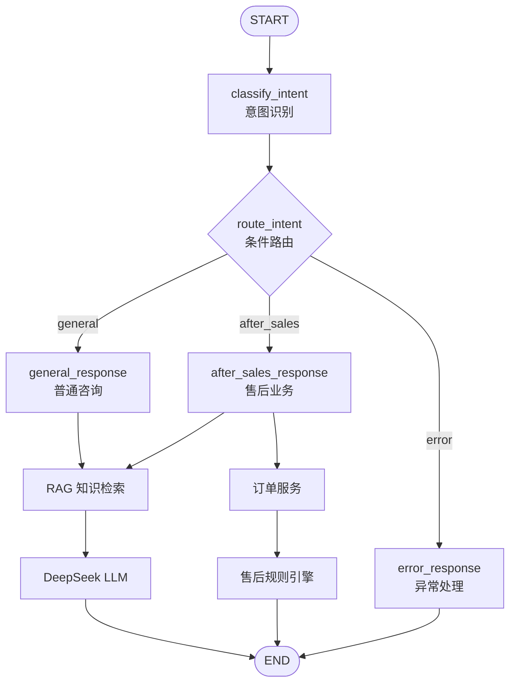
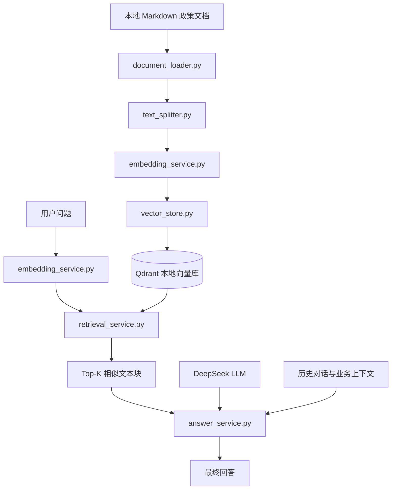

# EnterpriseServiceAgent

**基于 LangGraph、DeepSeek 和 RAG 的企业智能售后服务 Agent**

EnterpriseServiceAgent 是一个面向企业售后服务场景的智能客服 Agent 项目。系统结合大语言模型、LangGraph 工作流、RAG 知识库检索和规则引擎，实现用户意图识别、售后政策咨询、订单查询及售后申请资格判断。

项目采用 FastAPI 提供 API 服务，通过 LangGraph 实现多节点 Agent 工作流，并使用 BGE Embedding 和 Qdrant 构建本地向量知识库。

## 项目截图

### 前端对话界面



### 售后业务演示



## 1. 项目背景

企业售后服务场景中，用户通常会提出以下问题：

- 商品签收后多少天可以申请退货？
- 申请退款需要满足什么条件？
- 我的订单是否符合售后申请条件？
- 商品存在质量问题，应该如何申请售后？
- 超过售后期限还能否申请退货？

传统客服系统通常依赖固定关键词匹配和预设问答，难以灵活处理复杂问题及多轮对话。

本项目尝试通过 Agent 工作流，将大语言模型的自然语言理解能力、RAG 知识检索能力和确定性业务规则相结合，提高售后咨询与业务判断的处理能力。

## 2. 核心功能

### 2.1 Agent 工作流

基于 LangGraph 构建 Agent 工作流，实现：

- 用户意图识别。
- 根据识别结果进行条件路由。
- 普通咨询节点处理。
- 售后业务节点处理。
- 错误处理节点。
- 基于 LangGraph Checkpointer 的多轮会话状态管理。
- 使用 InMemorySaver 在服务进程运行期间保存会话状态。

**意图识别采用规则优先、LLM 兜底的混合分类机制：**

1. **规则优先识别：** 使用正则表达式识别订单编号、售后政策咨询和明确的业务办理请求，减少明显场景下不必要的模型调用。
2. **上下文感知：** 结合当前会话中的订单信息，识别用户对已有订单的连续追问，避免重复提供订单编号。
3. **LLM 兜底分类：** 对规则无法确定的消息，调用 DeepSeek 进行语义分类。
4. **结果校验与异常处理：** 对模型返回的意图进行合法性校验，模型调用异常或分类结果无效时进入错误处理分支。

通过规则与大模型结合，提高意图识别的可控性，并兼顾复杂自然语言表达的处理能力。

### 2.2 核心业务处理设计

**1. 普通咨询与售后业务分流**

通过 LangGraph 条件路由，将用户请求分发到普通咨询、售后业务和异常处理节点，实现不同业务场景的独立处理。

**2. 订单上下文管理**

基于 LangGraph Checkpointer 保存会话状态，结合订单编号和申请类型提取逻辑，支持同一会话中的连续订单追问，减少用户重复输入。

**3. 确定性售后规则引擎**

将订单查询与售后资格判断交由业务服务和规则引擎处理，不依赖大模型直接决定业务资格，提高业务判断的可控性。

**4. RAG 与业务规则协同**

普通咨询通过 RAG 检索售后知识库；售后场景先执行订单查询和规则判断，再将业务结果作为上下文传入 RAG，补充相关政策说明。

**5. 异常处理与降级机制**

对普通咨询、售后业务和政策检索分别设置异常处理。售后场景下，即使 RAG 检索失败，仍保留已经得到的订单信息和规则判断结果，保证核心业务逻辑不受影响。

**6. 确定性售后规则引擎**

使用 Python 实现售后基础资格判断，依次检查申请类型、订单存在性、支付状态、签收状态及签收时间。当前演示规则设定为签收后 7 天内可以进入后续审核，并通过统一的结果结构返回资格状态、判断原因和结果编码。

规则引擎与大模型回答生成相互独立，避免由 LLM 直接决定售后业务资格。符合基础申请条件不代表退款或退货已经最终批准。

### 2.3 RAG 知识库问答

构建完整的 RAG 检索问答流程：

1. 加载售后政策 Markdown 文档。
2. 对文档进行结构化切分。
3. 使用 BGE 模型生成文本向量。
4. 将向量存储至 Qdrant。
5. 根据用户问题检索相关知识片段。
6. 将检索结果交给 DeepSeek 生成回答。

主要功能：

- Markdown-aware 文档切分。
- 保留文档标题上下文。
- 向量相似度检索。
- 普通咨询支持最近三轮对话历史上下文。
- 支持 RAG 异常降级。

**知识库构建与向量检索**

基于 Markdown 售后政策文档构建本地 RAG 知识库。首先加载文档并进行分块处理，采用 500 的文本块长度和 100 的重叠长度；随后使用 Embedding 模型生成文本向量，并将文本块及向量写入 Qdrant。

用户提问时，将查询文本转换为向量，通过 Qdrant 检索相关文本块，再将检索内容、历史对话和业务上下文组合后传入 DeepSeek，生成有政策依据的回答。

当前知识库采用全量重建方式，检索通过 Top-K 控制返回文本块数量。

### 2.4 售后规则引擎

针对售后申请场景，使用独立规则引擎进行确定性业务判断。

主要校验内容：

- 订单是否存在。
- 订单是否已支付。
- 订单是否已签收。
- 是否满足项目设定的售后时间期限。
- 是否符合基础售后申请条件。

需要注意：符合基础申请条件仅表示可以进入人工审核流程，不代表最终审批通过或退款已经完成。

**模拟订单服务**

通过本地模拟订单数据实现订单查询，根据订单编号获取商品名称、订单金额、订单状态、支付状态及签收时间，并使用 Pydantic `OrderInfo` 模型统一订单数据结构，为售后规则引擎提供标准化订单信息。

当前版本使用内置模拟数据，尚未接入真实电商订单系统或外部数据库。

### 2.5 多轮对话

通过 `session_id` 管理用户会话，并将会话标识传递给 LangGraph 工作流。

支持：

- 客户端传入会话 ID。
- 未传入时自动生成 UUID。
- 基于会话标识维护工作流状态。
- 普通咨询节点保留最近三轮历史对话。
- 使用 InMemorySaver 保存运行期间的会话状态，服务重启后检查点数据不会保留。

**会话状态说明：**

当前使用 InMemorySaver 作为 Checkpointer，能够在服务进程运行期间根据相同的 `session_id` 恢复工作流状态。服务重启后，内存中的检查点数据不会保留。

### 2.6 异常处理

针对 RAG 服务异常进行降级处理。

在售后业务节点中，如果 RAG 调用失败，则保留规则引擎已经生成的业务判断结果。

普通咨询节点在 RAG 调用失败时返回错误提示。

Agent 工作流执行异常时，由 API 层统一捕获并返回 HTTP 502。

## 3. 系统架构

### 3.1 Agent 工作流架构



### 3.2 RAG 流程



### 3.3  RAG 问答与上下文增强

1. **多轮检索上下文增强：** 将最近三轮用户问题与当前问题拼接，缓解多轮对话中的指代和省略问题。
2. **向量知识检索：** 根据当前场景检索相关政策片段，并整理来源、相似度和文本内容。
3. **业务上下文注入：** 在售后场景中，将订单信息和规则引擎判断结果传入大模型，辅助生成政策解释。
4. **Prompt 约束：** 明确政策依据、信息不足处理、业务判断边界和参考来源要求，降低模型编造政策或擅自改变业务结论的风险。
5. **异常降级：** 普通咨询在 RAG 异常时返回友好提示；售后场景在政策检索失败时保留已有订单信息和规则引擎判断结果。

### 3.4 Qdrant 向量存储与检索

项目使用 Qdrant 本地持久化模式存储售后政策文本向量，无需单独部署 Docker 或远程向量数据库服务。

- **向量集合：** `after_sales_policies`
- **相似度算法：** Cosine（余弦相似度）
- **数据结构：** 每个文本块对应一个向量 Point，Payload 保存文本内容、来源文件及文本块序号。
- **知识库更新：** 采用全量重建方式，清理旧向量数据后重新写入。
- **检索策略：** 将用户问题转换为向量，通过 Qdrant 检索 Top-K 相似文本块，并返回文本内容、来源和相似度分数。

当前使用本地持久化存储，适用于项目演示和本地开发环境。

### 3.5 Embedding 向量化

项目使用 Sentence Transformers 加载 `BAAI/bge-small-zh-v1.5` 中文 Embedding 模型，将售后政策文本块和用户查询转换为语义向量。

- **模型：** BAAI/bge-small-zh-v1.5
- **模型加载：** 使用进程内单例方式，避免重复加载。
- **文本向量化：** 支持批量处理政策文本。
- **查询向量化：** 将用户问题转换为向量。
- **向量归一化：** 开启 `normalize_embeddings`，与 Qdrant Cosine 相似度检索配置配合使用。

文档向量和查询向量使用同一个 Embedding 模型，保证检索空间的一致性。

### 3.6 文档切分策略

项目采用基于 Markdown 结构的分层文本切分策略，尽可能保留知识文档的章节结构和语义完整性。

切分过程：

1. **Markdown 标题识别：** 根据标题层级划分文档章节，子章节保留父级标题信息。
2. **段落优先切分：** 优先按照段落边界组织文本，减少语义割裂。
3. **句子级切分：** 对过长段落进一步按照中英文标点进行切分。
4. **字符窗口兜底：** 对仍然过长的文本使用固定字符窗口切分。

默认配置为 `chunk_size=500`、`chunk_overlap=100`。其中长度单位为 Python 字符数，而非 Token 数。

每个文本块保留原始来源、文件名和文档内块序号，便于检索结果追溯。

## 4. 技术栈

| 技术 | 用途 |
|---|---|
| Python 3.11 | 项目开发语言 |
| FastAPI | 后端 API 服务 |
| LangGraph | Agent 工作流编排 |
| DeepSeek API | 大语言模型服务 |
| OpenAI Python SDK | 模型 API 调用 |
| Sentence Transformers | Embedding 模型加载 |
| BAAI/bge-small-zh-v1.5 | 中文文本向量化 |
| Qdrant | 向量数据库 |
| Pydantic | 请求与响应数据校验 |
| python-dotenv | 环境变量管理 |
| pytest | 自动化测试 |

## 5. 项目结构

```text
EnterpriseServiceAgent/
│
├── app/
│   ├── agents/
│   │   ├── intent_classifier.py
│   │   ├── nodes.py
│   │   ├── state.py
│   │   └── workflow.py
│   │
│   ├── api/
│   │   └── routes/
│   │       └── chat.py
│   │
│   ├── core/
│   │   └── config.py
│   │
│   ├── rag/
│   │   ├── answer_service.py
│   │   ├── document_loader.py
│   │   ├── embedding_service.py
│   │   ├── retrieval_service.py
│   │   ├── text_splitter.py
│   │   └── vector_store.py
│   │
│   ├── schemas/
│   │   └── chat.py
│   │
│   ├── services/
│   │   ├── after_sales_policy.py
│   │   ├── llm_service.py
│   │   └── order_service.py
│   │
│   └── main.py
│
├── data/
│   └── knowledge_base/
│       └── policies/
│           └── after_sales_policy.md
│
├── docs/
├── frontend/
│   └── app.py
├── reports/
├── scripts/
├── tests/
│
├── .env.example
├── .gitignore
├── requirements.txt
└── README.md
```

### 目录说明

| 目录 | 说明 |
|---|---|
| `app/agents/` | Agent 状态定义、意图识别、工作流节点及流程编排 |
| `app/api/` | FastAPI 路由与接口定义 |
| `app/core/` | 项目配置与环境变量管理 |
| `app/rag/` | 文档加载、文本切分、Embedding、向量检索及 RAG 回答服务 |
| `app/services/` | 大模型调用、订单服务及售后规则引擎 |
| `data/knowledge_base/` | 售后政策知识库原始文档 |
| `data/vector_store/` | 运行时生成的本地 Qdrant 向量数据库 |
| `frontend/` | Streamlit Web 前端界面 |
| `scripts/` | 项目调试、知识库构建及效果评估脚本 |
| `tests/` | 项目自动化测试 |
| `reports/` | 评估结果及相关报告 |

## 6. 环境配置

### 6.1 克隆项目

```bash
git clone <your-repository-url>
cd EnterpriseServiceAgent
```

### 6.2 创建虚拟环境

```bash
python -m venv .venv
```

Windows PowerShell 激活虚拟环境：

```powershell
.\.venv\Scripts\Activate.ps1
```

### 6.3 安装依赖

```bash
python -m pip install -r requirements.txt
```

### 6.4 配置环境变量

复制 `.env.example` 并创建项目根目录下的 `.env` 文件。

Windows PowerShell：

```powershell
Copy-Item .env.example .env
```

编辑 `.env`：

```dotenv
DEEPSEEK_API_KEY=your_deepseek_api_key_here
```

请替换为自己的 DeepSeek API Key。

**注意：不要将包含真实 API Key 的 `.env` 文件提交到 GitHub。**

## 7. 启动项目

首次运行项目或更新售后政策文档后，需要先构建知识库。

### 7.1 构建售后政策知识库

在项目根目录执行：

```bash
python scripts/check_rag_pipeline.py
```

该脚本将自动完成：

1. 加载售后政策 Markdown 文档。
2. 对文档进行结构化切分。
3. 使用 BGE Embedding 模型生成文本向量。
4. 清理 Qdrant 中已有的旧向量数据。
5. 将新的文本块及向量写入本地向量数据库。
6. 执行语义检索测试。

知识库构建成功后，会输出写入的文本块数量及检索测试结果。

**注意：**

- 每次重新构建都会清理旧向量数据，并根据当前政策文档重新写入。
- 当前实现采用全量重建方式，不支持增量更新。
- 首次运行时需要下载并加载 Embedding 模型，请确保具备相应的模型下载或本地缓存条件。

### 7.2 启动 API 服务

```bash
python -m uvicorn app.main:app --reload
```

### 7.3 启动前端

在另一个终端执行：

```bash
streamlit run frontend/app.py
```

前端默认通过 `http://127.0.0.1:8000` 访问后端，可通过环境变量 `BACKEND_API_URL` 覆盖。

### 7.4 访问服务

服务启动后，可以通过以下地址访问：

| 服务 | 地址 |
|---|---|
| API 服务 | http://127.0.0.1:8000 |
| Swagger API 文档 | http://127.0.0.1:8000/docs |
| 健康检查 | http://127.0.0.1:8000/health |
| 前端界面 | http://127.0.0.1:8501 |

## 8. API 接口说明

### POST /api/v1/chat

企业智能客服 Agent 对话接口。

**请求参数**

| 参数 | 类型 | 必填 | 说明 |
|---|---|---|---|
| message | string | 是 | 用户发送的消息，长度 1～2000 |
| session_id | string | 否 | 会话 ID，不传则自动生成 |

**请求示例**

```json
{
  "message": "我的订单 ORD202611001 有质量问题，我想申请退款。",
  "session_id": "demo-session-001"
}
```

**响应示例**

```json
{
  "reply": "根据订单信息，您的申请符合基础售后申请条件，可以进入人工审核流程。",
  "session_id": "demo-session-001"
}
```

以上回答仅为结构示例，实际回答由 Agent 工作流生成。

**多轮对话示例**

同一会话的后续请求使用相同的 `session_id`：

```json
{
  "message": "那需要准备什么材料？",
  "session_id": "demo-session-001"
}
```

**错误处理**

当 Agent 工作流执行失败时，接口返回 HTTP 502，并提供服务异常提示。

## 9. 项目评估

项目包含检索效果评估、回答质量评估和自动化测试。

### 9.1 RAG 检索效果评估

使用真实 Embedding 模型和 Qdrant 向量数据库进行检索评估。

| 评估指标 | 结果 |
|---|---:|
| 测试查询数量 | 10 |
| Hit@3 | 1.0000 |
| Hit@5 | 1.0000 |
| MRR | 0.9333 |

**说明：**

- Hit@3 和 Hit@5 均为 1.0，表示本次人工标注的 10 条查询中，相关知识片段均出现在对应 Top-K 结果中。
- MRR 为 0.9333，反映相关知识片段在检索结果中的排名情况。
- 评估结果仅代表当前测试集，不代表所有业务问题的检索效果。

### 9.2 回答质量评估

使用真实 DeepSeek API、BGE Embedding 和 Qdrant 进行问答评估。

采用人工评分方式，从以下维度进行评估：

| 评估维度 | 权重 |
|---|---:|
| 事实准确性 | 40% |
| 政策忠实性 | 30% |
| 回答完整性 | 20% |
| 业务边界遵守 | 10% |

当前初步评估结果：

| 指标 | 结果 |
|---|---:|
| 单轮问答 | 9 条 |
| 连续多轮问答 | 1 组 |
| 初步平均评分 | 95.6 / 100 |

**说明：95.6 分为初步人工评估结果，尚待人工逐项复核，不属于自动化客观评测结果。**

### 9.3 自动化测试

项目使用 pytest 对核心模块进行测试。

当前完整测试结果：

```text
77 passed
```

覆盖范围包括：

- Agent 工作流。
- 意图识别。
- 售后业务规则。
- 订单服务。
- RAG 文档加载与切分。
- Embedding 服务。
- 向量数据库。
- 知识检索。
- RAG 回答服务。
- API 接口。

运行测试：

```bash
python -m pytest -v
```

## 10. 项目边界与后续改进

当前项目是一个用于技术学习和能力展示的独立 Demo。

目前售后订单数据为模拟数据，售后规则为项目设定的模拟规则，不代表所有企业或平台的真实售后政策。

系统目前实现的是售后资格判断，并未接入真实支付、退款或企业订单系统，也不代表已经具备生产环境部署能力。

后续可以考虑：

- 接入真实业务数据库和订单系统。
- 增加更完善的 Agent 工具调用能力。
- 优化复杂问题的意图识别。
- 引入更系统化的 RAG 评估数据集。
- 增加回答质量自动化评估。
- 增加日志追踪与 Agent 执行过程监控。
- 完善用户权限与会话管理机制。
- 使用持久化 Checkpointer 实现跨服务重启的会话状态保存。

## 11. 项目总结

通过本项目，实践了从大语言模型 API 接入、Agent 工作流编排，到 RAG 知识库构建、业务规则引擎设计及系统评估的完整开发流程。

项目重点探索了大语言模型与确定性业务逻辑的协作方式：使用 LLM 处理自然语言理解和知识问答，使用规则引擎处理明确的业务资格判断，从而让 Agent 在具备自然语言交互能力的同时，保留关键业务判断的可控性。